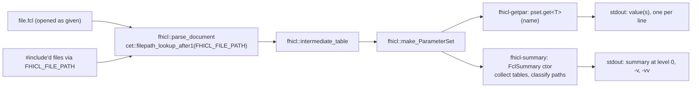

# mu2ebintools

> Two read-only FHiCL inspection command-line tools, `fhicl-getpar` and
> `fhicl-summary`, built against fhiclcpp and cetlib as a cetbuildtools/UPS
> product; no DAQ package calls them.

| | |
|---|---|
| Repository | `Mu2e/mu2ebintools` (public, issues enabled, no licence) |
| Language | C++ (515 lines in two files); CMake with cetbuildtools; UPS packaging |
| Version | `v1_01_21` (`ups/product_deps:3`, git tag `v1_01_21`) |
| Ports / services | none |
| Depends on | fhiclcpp `v4_12_02` and its cetlib (`ups/product_deps:8`); cetbuildtools `v7_17_01` to build (`:9`) |
| Consumers | none in `mu2edaq-main` (searched for `fhicl-getpar`, `fhicl-summary`, `mu2ebintools`) |
| Manual pages | `man/man1/fhicl-getpar.1`, `man/man1/fhicl-summary.1` |

Reviewed at `60450fe` on 2026-10-06 by reading the source. It was **not
built**: the review host has no fhiclcpp/cetlib/cetbuildtools or UPS.

## Purpose

Mu2e Offline jobs are configured in FHiCL. Shell scripts and people
sometimes need one value from a fully expanded configuration (after
`#include`, `@local::`, `@table::` and prolog handling) or an overview of an
art job's modules and paths, without running `art`. The package provides
exactly that:

- `fhicl-getpar` (Andrei Gaponenko, 2015) prints one parameter, decoded as a
  string, int, list of strings, or the keys of a table.
- `fhicl-summary` (Rob Kutschke, 2020) prints the process name, source,
  outputs, services, modules and paths of an art job, and classifies each
  path as trigger, end or ambiguous.

History: 40 commits, 2015-04 to 2020-11 plus one 2023-01 commit that tested
the move to GitHub; almost all are fhiclcpp/qualifier bumps. It predates
the DAQ superproject and is a submodule of `mu2edaq-main`
(`.gitmodules:55-57`), but nothing in the DAQ tree builds or calls it:
`testing/common.sh:23-50` (`pkg_list`) and `:102-113` (`pkg_cmake_dirs`)
omit it, so `mu2edaq-build-all.sh` never configures it.

## Architecture

Both programs follow the same pattern (`fhicl-getpar.cc:20-83`,
`fhicl-summary.cc:347-395`):

1. `-h`/`--help` as `argv[1]` prints usage to stdout and exits 0.
2. Argument count is checked (`getpar`: exactly 3; `summary`: 1 or 2);
   anything else throws.
3. `cet::filepath_lookup_after1 policy("FHICL_FILE_PATH")`: the top-level
   file is opened as given, includes are searched along `FHICL_FILE_PATH`
   (introduced by `95f06b8`, 2017).
4. `parse_document` → `make_ParameterSet`.
5. The work; any `std::exception` (fhiclcpp's `cet::exception` included) is
   caught, its `what()` printed to stderr, and the program exits 1.

## Components

### fhicl-getpar

`opt ∈ {--string, --int, --strlist, --keys}` selects
`pset.get<std::string>`, `get<int>`, `get<std::vector<std::string>>`, or
`get<fhicl::ParameterSet>(name).get_names()` (`fhicl-getpar.cc:49-70`).
Lines 72-74 are dead code (an unused `val` and a commented-out
`get_if_present`).

### fhicl-summary

`FclSummary` (`fhicl-summary.cc:79-138`) does all collection in its
constructor (`:253-285`). It reads:

- `process_name` and `source.module_type`;
- the member names of `services`, `outputs` and `physics`, and of
  `physics.{producers,analyzers,filters}`;
- `physics.trigger_paths` and `physics.end_paths` as string lists;
- `<table>.<label>.module_type` for every output and module.

It then calls `classifyPaths()` (`:399-432`). Every name under `physics`
other than the five reserved ones (`:255`) is a candidate path, read with
`_pset.get<strlist>("physics."+name)` (`:402`). Each label is classified by
`classifyModule` (`:213-223`): exactly one of producer/filter/analyzer/output
gives trigger or end, anything else gives ambiguous. A path is trigger or end
only if all of its labels agree.

Because classification is in the constructor, a non-reserved, non-sequence
entry under `physics` aborts every invocation, including the default level.
Output is produced by `verbosity0/1/2` (`:288-345`). `verbosity0` gates the
services count on `_hasProducers` (`:294`), which is a bug (MBT-001).

## Interfaces

Command line, output format and exit status: [INTERFACES.md](INTERFACES.md)
and the two man pages. There is no library, no header (`install_headers()` in
`mu2ebintools/CMakeLists.txt:12` installs nothing), no configuration file and
no network or IPC interface.

## Configuration

`FHICL_FILE_PATH` is the only input besides the arguments.

## Operations

Build and publish are UPS-era procedures (`README`, now explained in
[INSTALL.md](INSTALL.md)). The build requires cetbuildtools
(`CMakeLists.txt:22-26` aborts without `CETBUILDTOOLS_VERSION`) and declares
`cmake_minimum_required(VERSION 2.8)` (`:16`). CMake 4.0 removed
compatibility with versions below 3.5, so a CMake ≥ 4 configure fails at line
16. That was not reproduced here, because running a configure was not
permitted in this session. The `product_deps` qualifiers are `e19`/`e20`
(gcc 8/9). The `README` example targets `slf6` with `e10`. Nothing in the
repository targets Spack, which Mu2e's DAQ stack now uses
(`mu2e-tdaq-suite/CMakeLists.txt:1`).

## Interactions with other packages

None at run time, and none inside `mu2edaq-main`. External build
dependencies: fhiclcpp, cetlib, cetlib_except, cetbuildtools, UPS.

## Review findings

Staged in [`ISSUES-PENDING.md`](ISSUES-PENDING.md).

| ID | Sev | Title |
|---|---|---|
| MBT-001 | S3 | `fhicl-summary` default output gates the services count on `physics.producers` |
| MBT-002 | S3 | build needs retired cetbuildtools/UPS and declares CMake 2.8; sources rely on transitive standard headers |
| MBT-003 | S4 | positional-only arguments and a single exit code for every failure |
| MBT-004 | S4 | no tests, no CI, no LICENSE; `README` publishing recipe is SLF6-era |
| MBT-005 | S4 | purpose in `mu2edaq-main` undeclared: no DAQ package builds or calls it |
